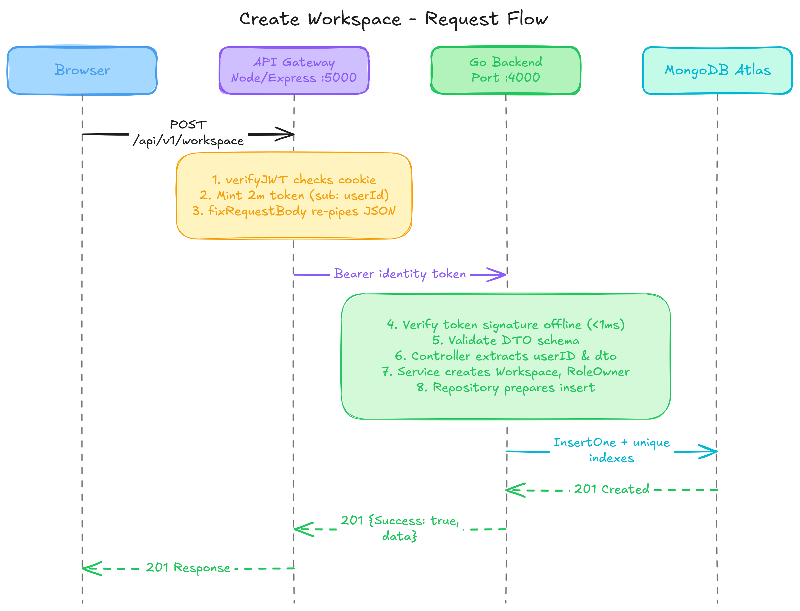

# DotConnect Backend Service

DotConnect is a Go HTTP service that creates workspaces in MongoDB. It validates bearer identity tokens and workspace request payloads before storing each workspace with its creator as the owner.



## Requirements

- Go 1.27.1 (the version declared in `go.mod`)
- A MongoDB deployment reachable through a TLS-enabled connection URI

## Configuration

The service loads environment variables from the process environment and attempts to load a `.env` file from the working directory. Set the following values before starting the service:

| Variable                | Purpose                                           |
| ----------------------- | ------------------------------------------------- |
| `PORT`                  | HTTP listen port, with or without a leading colon |
| `MONGODB_URI`           | TLS-enabled MongoDB connection URI                |
| `DB_NAME`               | MongoDB database name                             |
| `DOTCONNECT_COLLECTION` | Collection used to store workspaces               |
| `INTERNAL_SECRET`       | HMAC secret used to verify identity tokens        |

Keep secrets out of source control. The service does not issue identity tokens; it expects a caller such as the API gateway to provide a valid token.

## Run

From the repository root, provide the configuration and start the server:

```powershell
$env:PORT = "4000"
$env:MONGODB_URI = "<TLS-enabled MongoDB URI>"
$env:DB_NAME = "<database name>"
$env:DOTCONNECT_COLLECTION = "<collection name>"
$env:INTERNAL_SECRET = "<shared HMAC secret>"
go run .
```

At startup, the service connects to MongoDB and creates indexes for unique workspace slugs and workspace-member user IDs. It then listens on the configured port.

## API

### Create a workspace

```http
POST /api/v1/workspace/
Authorization: Bearer <identity-token>
Content-Type: application/json
```

The same handler is also mounted at `POST /workspace/` and `POST /`.

The token must use an HMAC signing method and contain an issuer of `api-gateway` and an audience whose first entry is `dotconnect-go-service`. Its `userId` claim becomes the initial workspace owner's ID.

Request body:

```json
{
  "name": "Design Team",
  "slug": "design-team",
  "description": "A shared space for the design team"
}
```

`name` is required and must contain 3-80 printable ASCII characters. `slug` is optional and, when provided, must contain 3-100 lowercase printable ASCII characters. Slugs must be unique across workspaces. The current implementation stores an omitted slug as an empty value, so only one workspace can be created without a slug before the unique-index constraint rejects subsequent inserts. `description` is optional and limited to 1,000 characters. Unknown JSON fields are rejected.

Successful creation returns HTTP `201 Created` with a JSON response containing `Success`, `Message`, and the created workspace in `data`. Authentication, payload decoding, and validation errors return an HTTP error response.

## Project layout

| Directory/file                   | Responsibility                                                       |
| -------------------------------- | -------------------------------------------------------------------- |
| `main.go`, `app/`                | Load configuration, connect dependencies, and start the HTTP server  |
| `router/`                        | Configure CORS and mount workspace routes                            |
| `middlewares/`, `auth/`          | Verify bearer identity tokens and decode/validate workspace requests |
| `controllers/`                   | Translate HTTP requests into service calls and format responses      |
| `services/`                      | Apply workspace creation rules and assign the owner                  |
| `repositories/`                  | Persist workspace records in MongoDB                                 |
| `schemas/`, `dto/`, `validator/` | Define stored models, request payloads, and validation               |
| `config/`                        | Load environment values and configure the MongoDB connection/indexes |
| `utils/`                         | JSON encoding/decoding and HTTP response helpers                     |

## Development

Build the service with:

```powershell
go build .
```

The repository currently implements workspace creation; additional workspace operations can be added alongside the existing route, controller, service, and repository layers.
